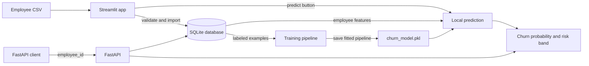
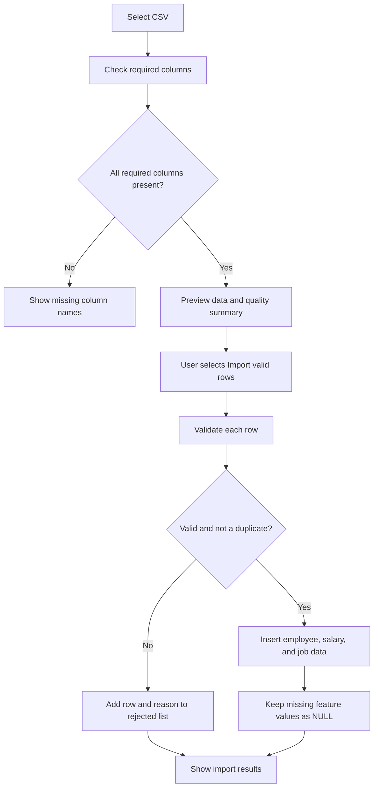
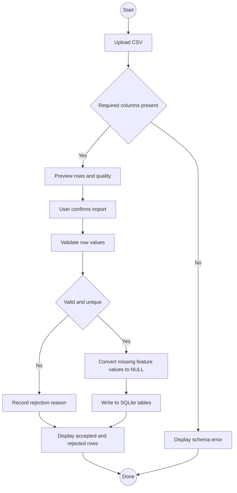
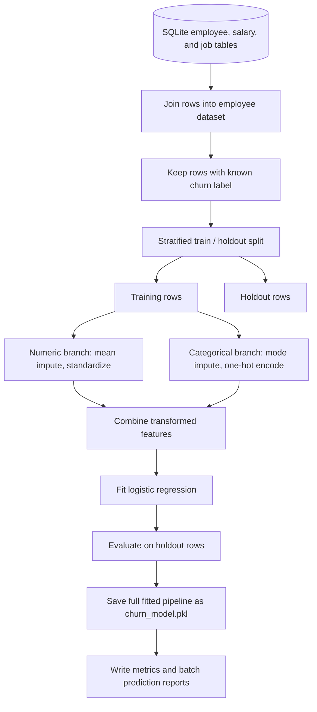
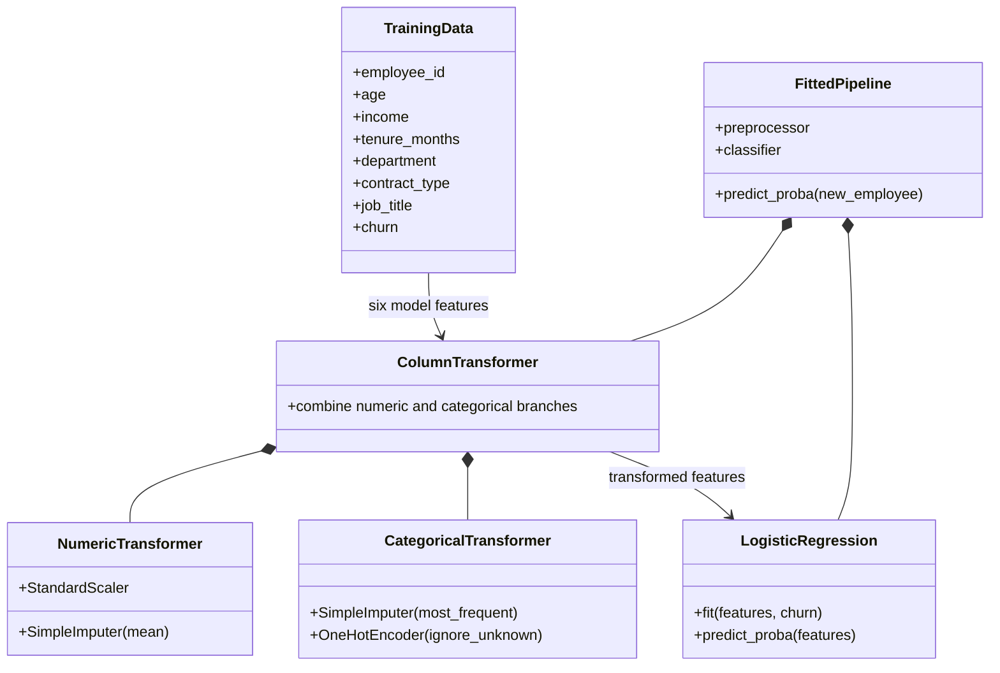
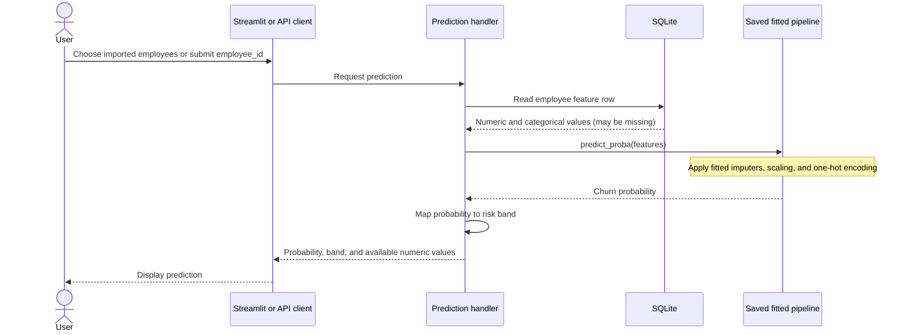
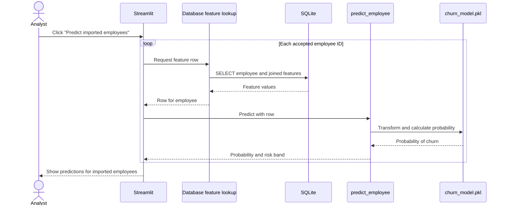
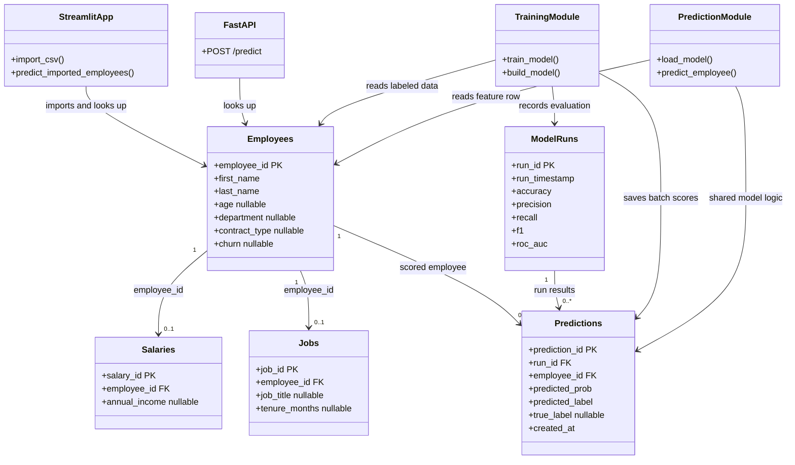

# Employee Churn Intelligence

An interactive employee-churn project that stores employee records in SQLite, trains a scikit-learn classification pipeline, and makes predictions through a Streamlit app or a FastAPI endpoint.

> **New here?** Follow the quick start first. Then explore the diagrams to see how an uploaded row travels through the database, training pipeline, and prediction flow.

## Project at a glance



### What the app does

- **Imports:** previews a CSV, checks required columns and row values, and reports accepted and rejected records.
- **Stores:** saves employee identity, features, and optional observed churn labels in SQLite.
- **Trains:** fits numeric and categorical preprocessing together with a logistic-regression classifier.
- **Predicts:** scores imported records from Streamlit or an individual employee through FastAPI.
- **Evaluates:** records model metrics and predictions for labeled employees in SQLite.

**Important:** uploading records does not automatically retrain the model. Use the explicit **Predict imported employees** button to score accepted rows with the current model. Retraining is a separate step.

## Quick start

### 1. Set up Python

Open PowerShell in the project folder and run:

```powershell
py -m venv venv
venv\Scripts\Activate.ps1
python -m pip install -r requirements.txt
```

If PowerShell blocks activation in this terminal, allow it for the current process and activate again:

```powershell
Set-ExecutionPolicy -Scope Process -ExecutionPolicy RemoteSigned
venv\Scripts\Activate.ps1
```

### 2. Initialize and seed the database

```powershell
python -c "from churn_app.database import init_db, populate_sample_data; init_db(); populate_sample_data()"
```

This creates the SQLite tables and adds example employees if the employee table is empty. Existing employee records are not replaced.

### 3. Train the model

```powershell
python -m churn_app.train_and_evaluate
```

The command reads employee data from SQLite, trains and evaluates the model, saves the fitted model artifact, and writes reports to the `artifacts` folder:

| Output | What it contains |
|---|---|
| `churn_model.pkl` | Fitted preprocessing and classification pipeline used by the apps |
| `artifacts/metrics.json` | Holdout evaluation metrics and model run ID |
| `artifacts/training_data.csv` | Labeled rows used in supervised training |
| `artifacts/batch_predictions.csv` | Predictions generated for labeled training rows |

The database and model paths can be changed with `CHURN_DB_PATH` and `CHURN_MODEL_PATH`. For example, in PowerShell:

```powershell
$env:CHURN_DB_PATH = "C:\data\employees.db"
$env:CHURN_MODEL_PATH = "C:\data\churn_model.pkl"
python -m churn_app.train_and_evaluate
```

### 4. Run the Streamlit app

```powershell
python -m streamlit run streamlit_app.py
```

In the browser:

1. Choose a CSV in the **Batch import** section.
2. Review the preview and data-quality summary.
3. Select **Import valid rows**.
4. Review how many rows were imported or rejected.
5. Select **Predict imported employees** to score the accepted rows.

Streamlit loads the local `churn_model.pkl` and predicts directly; FastAPI does not need to be running for Streamlit predictions.

### 5. (Optional) Run the FastAPI service

In a separate terminal, activate the same environment and run:

```powershell
python -m uvicorn churn_app.api:app --reload --host 127.0.0.1 --port 8000
```

Open `http://127.0.0.1:8000/docs` to try the API interactively. The prediction endpoint accepts an employee ID:

```http
POST http://127.0.0.1:8000/predict
Content-Type: application/json

{
  "employee_id": 1
}
```

The API returns the churn probability, risk band, and available numeric feature values for that employee.

## Follow a row through the data pipeline

The CSV importer expects these columns: `first_name`, `last_name`, `age`, `department`, `contract_type`, `annual_income`, `job_title`, and `tenure_months`. A `churn` column is optional; if present, accepted values are `0`, `1`, or missing.

First and last names are required to identify a record. Missing model features are allowed and stored as SQL `NULL`. Non-missing age and tenure values must be whole numbers in the accepted ranges; income must be non-negative. Department and contract values are checked against the app’s known values. Invalid rows and duplicate records are reported rather than imported.



### Data pipeline UML activity diagram



## How the model learns

The model is trained from the database tables joined into one employee-level dataset. Only rows with a known `churn` label are eligible for supervised training. Missing churn labels stay missing; the project does not invent outcomes.

| Feature group | Columns | Training preprocessing |
|---|---|---|
| Numeric | `age`, `income`, `tenure_months` | Fill missing values with each feature’s training-set mean, then standardize |
| Categorical | `department`, `contract_type`, `job_title` | Fill missing values with the most frequent training-set value, then one-hot encode |
| Target | `churn` | Binary label; unlabeled rows are excluded from fitting |

The labeled examples are split into training and holdout sets. Imputation and scaling/encoding are fitted as part of the pipeline on the training split, so the holdout set and future predictions receive the learned transformations without fitting preprocessing on those rows. Logistic regression classifies the transformed features.



### Model pipeline UML component diagram



## How predictions work

Streamlit and FastAPI share the same database feature lookup and prediction function. The saved artifact includes its fitted imputers, scaler, encoder, and classifier. Missing values are transformed using training-time statistics; a category not seen during training is ignored by the one-hot encoder rather than causing a prediction error.

The returned risk band is based on the probability: `low` below `0.4`, `medium` from `0.4` to below `0.7`, and `high` at `0.7` or above.



### Prediction flow UML sequence diagram



### UML class diagram: application and data



## Retrain after changing the data or model

Newly uploaded rows are available in SQLite, but the already-fitted model does not learn from them automatically. To include new observed labels in training:

1. Import the updated dataset, including `churn` values where known.
2. Run `python -m churn_app.train_and_evaluate`.
3. Review `artifacts/metrics.json` and the generated batch predictions.
4. Use the newly generated `churn_model.pkl` with the app.

Rows without churn labels remain stored and can be predicted, but are left out of model fitting. If a numeric feature or categorical feature has no observed training values, training stops with an explanatory error because the imputer cannot learn a replacement value.

When deploying, package the code, dependencies, trained model artifact, and a database containing the employee data you expect to query. SQLite is a local file: separate deployments or instances will not automatically share its contents. On hosting platforms with ephemeral filesystems, database changes may not survive restarts, so use persistent storage or a shared database if that is required. After replacing the model artifact, restart/redeploy the app so Streamlit’s cached model is loaded again; FastAPI loads its model when the service starts.

## Explore the code

| File | Purpose |
|---|---|
| `streamlit_app.py` | Upload UI, row import, dashboards, and local prediction button |
| `churn_app/database.py` | SQLite schema, import validation, feature lookup, and training-data queries |
| `churn_app/training.py` | Feature definitions, preprocessing pipeline, training, evaluation, and artifact saving |
| `churn_app/prediction.py` | Model loading, employee scoring, and risk-band mapping |
| `churn_app/api.py` | FastAPI application and `POST /predict` route |
| `churn_app/train_and_evaluate.py` | Command-line training and report export |
| `train_churn_model.ipynb` | Notebook-based exploration using the shared model pipeline |

## Try the drift experiment

The Streamlit app includes an **Import noisy experiment dataset** section for `noisy_churn_experiment.csv`. The example dataset introduces shifted feature distributions, extreme but valid values, scenario labels, and a duplicate to explore import validation and changes in model behavior. Review its quality summary and rejected rows, then explicitly retrain if you want labeled experiment rows to affect the model.
