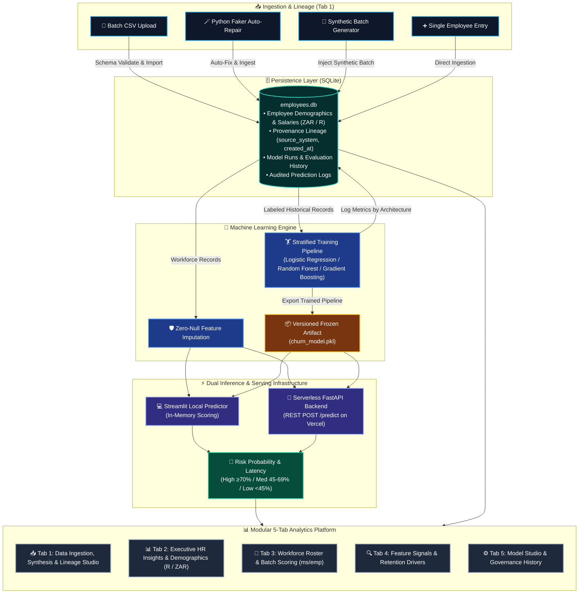
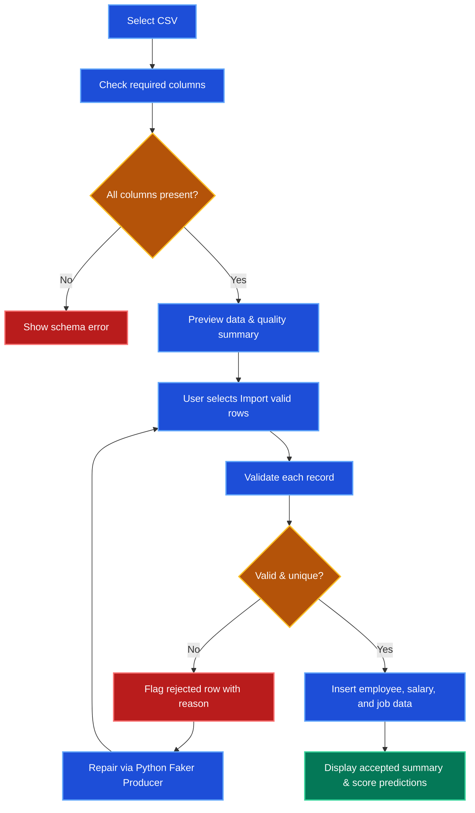
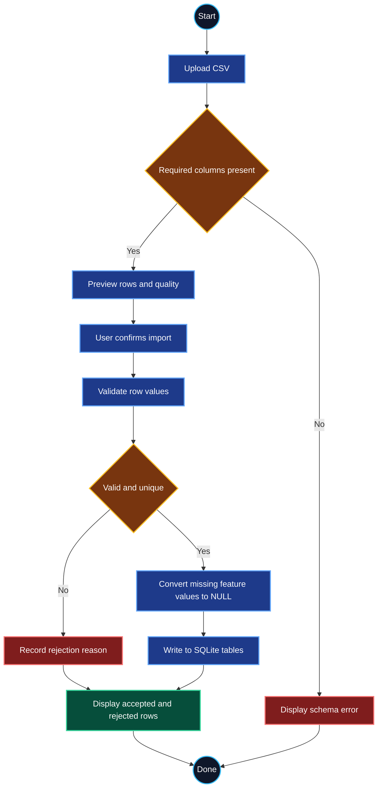
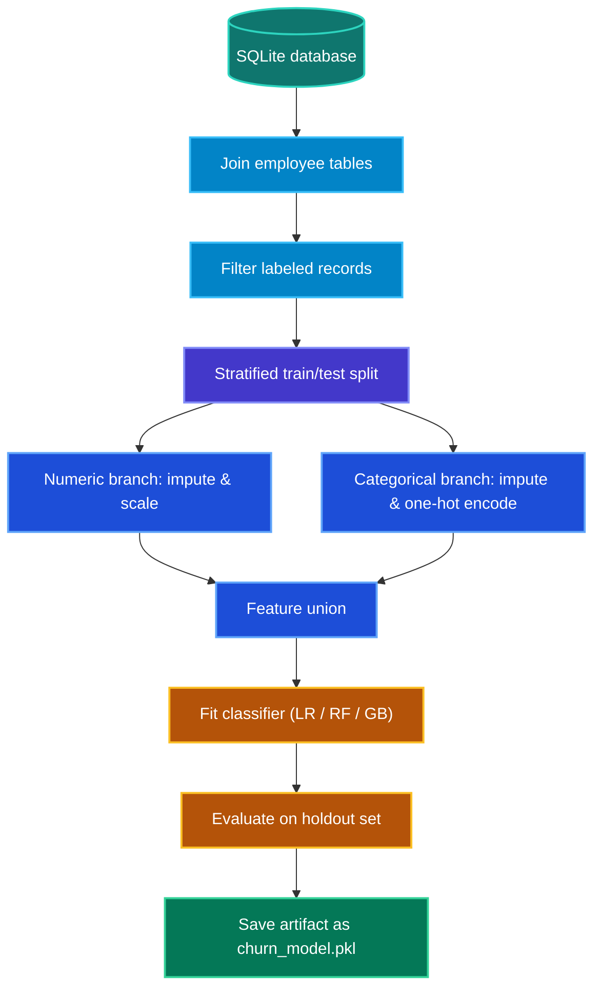
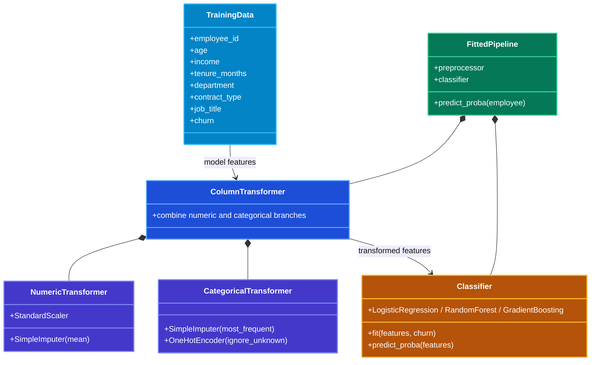
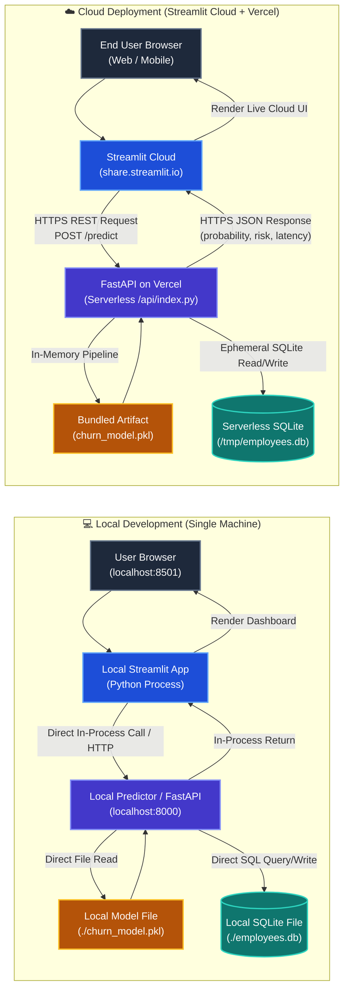
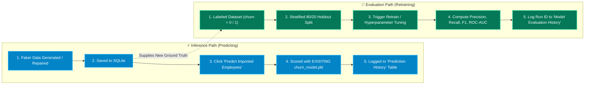

# 🏢 Employee Churn Intelligence & Full-Stack ML Serving Platform

An enterprise-ready machine learning and workforce analytics platform that predicts employee turnover risk, explores demographic drivers, and serves predictions through an interactive 5-tab Streamlit dashboard and a serverless FastAPI backend.

All financial metrics, salary benchmarks, and compensation modeling are standardized in **South African Rands (R / ZAR)**.

---

## 📌 Project at a Glance



---

## ✨ Core Features & Platform Capabilities

- **📊 Modular 5-Tab Enterprise Dashboard:** Cleanly organized into Data Ingestion & Lineage Studio, Executive HR Insights, Workforce Roster Scoring, Feature Signals, and Model Governance.
- **🔍 End-to-End Data Lineage & Provenance Explorer:** Filter and audit every employee record by creation origin (`csv_import`, `faker_synthetic`, `faker_repaired`, `manual_entry`, `seed_baseline`) with provenance source distributions.
- **🛠️ Automated Row-Level Data Quality Diagnosis:** Categorizes dataset issues in real time into **Missing Values**, **Duplicate Records**, **Invalid Range Outliers**, **Invalid Categories**, and **Clean Records**.
- **🎯 Dynamic Cohort Drill-Down Filters:** Filter demographic charts and KPI cards by Department, Contract Type, Age, and Tenure in real time.
- **🏢 Department Turnover & Salary Disparity Analytics:** Side-by-side benchmark tables and distribution charts comparing retained vs. churned employees across departments.
- **👥 Age Cohort Vulnerability Analysis:** Cohort analysis across 5 age brackets (`< 25`, `25–34`, `35–44`, `45–54`, `55+`) identifying turnover patterns.
- **🪄 Python Faker Producer & 1-Click Repair:** Synthesizes realistic identities and repairs rejected CSV records automatically without poisoning model weights.
- **🧪 Synthetic Batch Generator:** Injects configurable stress-test batches (5 to 50 records) directly into SQLite on demand.
- **🛡️ Zero-Null Feature Imputation:** Imputes missing numerical and categorical features prior to scoring using database-learned central tendencies.
- **🎛️ Multi-Model Hyperparameter Tuning:** Interactively tune and compare **Logistic Regression**, **Random Forest**, and **Gradient Boosting** pipelines with full metric history tracking by model architecture.
- **⚡ Millisecond Prediction Latency:** Measures real-time scoring benchmark latency (ms/employee) during batch scoring.
- **🚀 Dual-Serving Infrastructure:** Score employees locally via Streamlit or serve predictions over public REST API via FastAPI on Vercel Serverless.

---

## 🚀 Quick Start Guide

### 1. Environment Setup

Open PowerShell in the project directory:

```powershell
py -m venv venv
venv\Scripts\Activate.ps1
python -m pip install -r requirements.txt
```

### 2. Initialize and Seed SQLite Database

```powershell
python -c "from churn_app.database import init_db, populate_sample_data; init_db(); populate_sample_data()"
```

This creates the SQLite tables (`employees`, `salaries`, `jobs`, `model_runs`, `predictions`, `inference_predictions`) and inserts baseline sample records.

### 3. Train the Model Pipeline

```powershell
python -m churn_app.train_and_evaluate
```

This trains the scikit-learn pipeline, generates `churn_model.pkl`, and exports evaluation reports to `artifacts/`:

| Artifact | Description |
| :--- | :--- |
| `churn_model.pkl` | Serialized preprocessing pipeline and fitted classifier |
| `artifacts/metrics.json` | Holdout accuracy, precision, recall, F1, and ROC-AUC |
| `artifacts/training_data.csv` | Labeled rows used in supervised training |
| `artifacts/batch_predictions.csv` | Holdout predictions generated during evaluation |

### 4. Run the Streamlit Dashboard

```powershell
python -m streamlit run streamlit_app.py
```

Open `http://localhost:8501` to access the interactive dashboard.

### 5. (Optional) Run the FastAPI Service Locally

```powershell
python -m uvicorn churn_app.api:app --reload --host 127.0.0.1 --port 8000
```

Interactive OpenAPI documentation is available at `http://127.0.0.1:8000/docs`.

---

## 📑 5-Tab Enterprise Dashboard Architecture


### ⚙️ Operations Sidebar
- **Cloud API Switch:** Route predictions locally or to a deployed Vercel FastAPI backend.
- **Active Model Status Badge:** Real-time model architecture, holdout ROC-AUC, and F1 score indicator.
- **5-Tab Navigation Guide:** Quick reference for all platform analytics and governance tabs.

### 📥 Tab 1: Data Ingestion, Synthesis & Lineage Studio
- **Segmented Ingestion Mode Selector:** Switch between **Batch CSV Import & Auto-Repair**, **Synthetic Batch Generator**, and **Single Employee Manual Entry** across dedicated full-width containers.
- **Batch CSV Ingestion & Quality Diagnostics:** Upload rosters, download packaged test datasets (`data/Bulk_import_Data/`), view quality categorization (Missing Values, Duplicates, Outliers), duplicate file ingestion protection (`is_source_imported`), and trigger **🪄 1-Click Faker Auto-Repair**.
- **Synthetic Batch Producer:** Generate 5–100 realistic employee records with controllable baseline churn bias (5%–80%).
- **Single Employee Manual Entry:** Manual record creation with South African Rand compensation and instant local ML risk scoring.
- **🔍 Data Lineage & Provenance Explorer (Full-Width):** Dropdown filter (`<filename>.csv`, `faker_repaired (<filename>.csv)`, `faker_synthetic`, `manual_entry`, `seed_baseline`) with provenance distribution and timestamped audit records.
- **📊 SQLite Database Health:** Real-time scorecard tracking duplicate, missing, and invalid records alongside database schema inspection.

### 📊 Tab 2: Executive HR Insights & Demographics
- **Dynamic Filter Bar:** Interactive multi-select filters for Departments, Contract Types, and Age Range.
- **Macro KPI Ribbon:** Filter-aware Headcount, Retention Rate (%), Churn Rate (%), Average Annual Salary (ZAR / R), and Average Tenure.
- **Department Turnover Distribution:** Interactive Plotly stacked bar chart comparing Retained vs. Churned employees by department with hover tooltips.
- **Department Benchmark Table:** Side-by-side comparative table showing Headcount, Churn %, Average Annual Salary (Retained vs. Churned in R), and Average Tenure.
- **Age Cohort Vulnerability Analysis:** Interactive Plotly grouped bar chart across 5 cohorts (`< 25`, `25–34`, `35–44`, `45–54`, `55+`).
- **Contract Type Employment Dynamics:** Interactive Plotly horizontal stacked bar chart.
- **Dedicated Salary Distribution Row:** Interactive Plotly overlay histogram and **📊 Salary Benchmark Statistics Card** (Mean, Median, Min, Max annual compensation disparity in Rands).

### 👥 Tab 3: Workforce Roster & Predictions
- **Active Workforce Roster:** Searchable and sortable roster table with zero-null feature imputation.
- **1-Click Batch Scoring:** Score all roster employees with millisecond-per-employee latency benchmarking.
- **📊 Batch Prediction Evaluation Scorecard:** Automatic evaluation against labeled ground-truth records (Batch Accuracy, Precision, Recall, F1-Score, and ROC-AUC) with an interactive Plotly confusion matrix heatmap.
- **Scored Predictions Table with Ground Truth:** Displays probabilities, risk tiers, and actual ground truth status (`Retained (0)` vs `Churned (1)`).
- **Risk Categorization Breakdown:** Categorization into **High Risk** ($\ge 70\%$), **Medium Risk** ($45-69\%$), and **Low Risk** ($< 45\%$) with interactive Plotly distribution chart and proportion table.

### 🔍 Tab 4: Feature Signals & Retention Drivers
- **Interactive Correlation Heatmap:** Cell-level correlation annotations with Plotly hover tooltips (Modes: *Top Correlated with Churn* and *Numeric Features*).
- **Ranked Key Signals Table:** Features ranked by absolute influence with directional risk tags.
- **Model Learned Feature Influence:** Interactive horizontal Plotly bar chart indicating features promoting retention vs. increasing turnover risk.

### ⚙️ Tab 5: Model Studio & Evaluation History
- **Interactive Hyperparameter Tuning:** Tune and train **Logistic Regression**, **Random Forest**, or **Gradient Boosting** models in real time.
- **Model Evaluation Runs History:** Audit table logging `run_id`, `model_architecture`, `accuracy`, `precision`, `recall`, `f1`, and `roc_auc`.
- **Run Deep-Dive Analytics:** Interactive Confusion Matrix Heatmap, Interactive Plotly ROC Curve with holdout AUC, and Prediction Distribution Histogram.
- **Audited Prediction Log:** Date-filtered historical log of all scoring events with ground-truth verification.

---

## 📐 Data Pipeline & Model Architecture

### How the Data Pipeline Works



<details>
<summary><strong>📊 Click to toggle Data Pipeline UML Activity Diagram</strong></summary>



</details>

---

### How the Model Learns



<details>
<summary><strong>📐 Click to toggle Model Pipeline UML Component Diagram</strong></summary>



</details>

---

## ☁️ Architecture Comparison: Local vs. Cloud Deployment



| Dimension | Local Development | Streamlit Cloud + Vercel Deployment |
| :--- | :--- | :--- |
| **Frontend UI** | Streamlit running locally on `http://localhost:8501` | Hosted globally on **Streamlit Community Cloud** |
| **Backend & API** | Local FastAPI process on `http://127.0.0.1:8000` | Serverless Python function on **Vercel** (`https://your-app.vercel.app`) |
| **Communication** | Direct in-memory Python function call or local loopback | Public **HTTPS REST API** (`POST /predict`) with CORS enabled |
| **Database** | Persistent SQLite read/write to root `./employees.db` | Read-only bundle copied to ephemeral `/tmp/employees.db` on cold start |
| **Model Artifact** | Local file access from root `./churn_model.pkl` | Bundled in serverless package and loaded into memory on cold start |
| **Scalability** | Single machine CPU process | **Auto-scaling serverless instances** on-demand |

---

## ⚡ Decoupled Inference vs. Retraining Pipeline

### Why Evaluation Metrics Don't Change Automatically During Inference

In this architecture, **Inference (Prediction)** and **Model Evaluation (Training)** are deliberately decoupled:



#### Production Best Practice
> **Decoupling prediction from retraining** prevents silent model drift and accidental model poisoning from untested data.
> It guarantees sub-millisecond prediction latency and ensures every set of evaluation metrics is cleanly tied to a versioned **Run ID** in the database.

---

## 📁 Repository Structure

| File / Folder | Purpose |
| :--- | :--- |
| `streamlit_app.py` | 5-tab interactive HR dashboard and streamlined operations sidebar |
| `churn_app/__init__.py` | Package initialization and top-level module exports |
| `churn_app/api.py` | FastAPI application and `POST /predict` inference endpoint |
| `churn_app/database.py` | SQLite schema, data quality diagnosis, lineage tracking, and audit persistence |
| `churn_app/faker_producer.py` | Python Faker Producer for synthetic batch generation and 1-click row repair |
| `churn_app/feature_engineering.py` | Central tendency baseline calculations and zero-null feature imputation layer |
| `churn_app/training.py` | Pipeline architectures (LogReg, Random Forest, GradBoost), tuning, and metrics |
| `churn_app/prediction.py` | Model loader, single-employee scoring, and risk band classifier |
| `churn_app/train_and_evaluate.py` | CLI training runner and evaluation artifact generator |
| `churn_app/schemas.py` | Pydantic validation schemas for API inputs and responses |
| `churn_app/config.py` | Project path configuration and database file references |
| `api/index.py` | Serverless entrypoint for Vercel cloud deployment |
| `vercel.json` | Vercel deployment routing and python serverless configuration |
| `requirements.txt` | Python package dependencies (FastAPI, Streamlit, Scikit-learn, Anyio, etc.) |
| `employees.db` | Local SQLite database storing employees, salaries, jobs, runs, and predictions |
| `churn_model.pkl` | Serialized active machine learning model pipeline artifact |
| `artifacts/` | Holdout evaluation metrics (`metrics.json`), snapshots, and architecture documentation |
| `data/` | Historical datasets, stress-test files, and bulk import test rosters |
| `data/Bulk_import_Data/` | Ready-to-download bulk CSV rosters (900-row noisy, clean benchmark, raw stress-test) |
| `notebooks/` | Jupyter notebooks for exploratory data analysis and model experimentation |

---

## 🔮 Future Roadmap & Integrations

- **Pulse360 Platform Integration**: Connect this employee churn intelligence engine directly with the **Pulse360** platform to ingest real-time engagement telemetry, 360-degree feedback signals, and sentiment trends for continuous workforce attrition modeling and proactive retention interventions.

---

*Documentation and architecture diagrams created via IBM Bob.*
