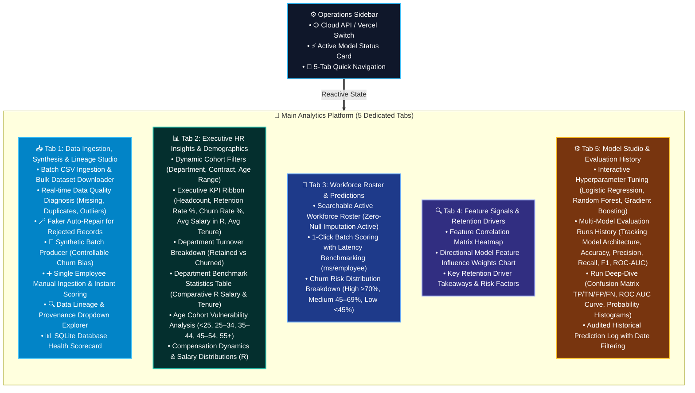
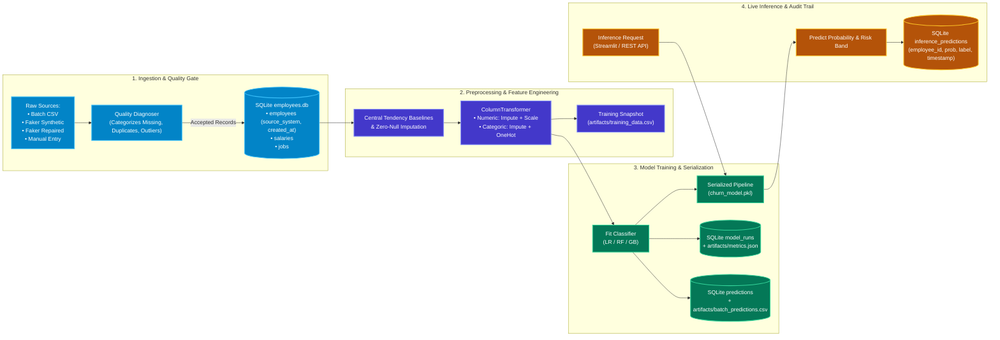

# Implementation Summary & Technical Architecture

This document details the complete 5-tab stakeholder architecture, end-to-end data pipeline lineage, storage/auditing governance, currency localization (South African Rand - ZAR / R), and model evaluation tracking across machine learning algorithms.

---

## 1. Executive Implementation Overview: 5-Tab Enterprise Architecture

The Employee Churn Intelligence platform is structured into a streamlined persistent operations sidebar and a 5-tab modular stakeholder hub:

---

## 2. End-to-End Pipeline Lineage, Storage & Auditing Governance

### Where Data is Saved, Tracked, and Audited Across Stages

### Storage and Audit Tracking Matrix

| Pipeline Stage | Storage Location | Lineage & Audit Identifiers | How to Audit Later |
| :--- | :--- | :--- | :--- |
| **Ingestion** | SQLite `employees`, `salaries`, `jobs` | `employee_id`, `source_system` (`csv_import`, `faker_synthetic`, `faker_repaired`, `manual_entry`, `seed_baseline`), `created_at` | Filter records in **Tab 1: Lineage Explorer** by source system dropdown or run SQL queries on `employees.db`. |
| **Feature Engineering** | In-Memory `impute_and_engineer_features` & `artifacts/training_data.csv` | Feature schema versions, baseline median/mode values computed from database | Inspect `artifacts/training_data.csv` or compare features across historical runs. |
| **Model Evaluation** | SQLite `model_runs`, `predictions` & `artifacts/metrics.json` | `run_id`, `model_type`, `run_timestamp`, holdout precision/recall/F1/ROC-AUC | Query `model_runs` table in **Tab 5: Model Studio** or read `artifacts/metrics.json`. |
| **Model Artifact** | Root `./churn_model.pkl` | Serialized fitted pipeline with preprocessing + classifier steps | Loaded dynamically in `churn_app/prediction.py` with file timestamp check. |
| **Live Inference** | SQLite `inference_predictions` | `prediction_id`, `employee_id`, `predicted_prob`, `predicted_label`, `true_label`, `created_at` | Audit via the date-range filter in **Tab 5: Prediction Audit History** or query `inference_predictions`. |

---

## 3. Multi-Model Architecture & Evaluation Governance

The platform provides explicit model architecture tracking across all evaluation runs, allowing stakeholders to benchmark which classification algorithms achieve the highest discriminatory power for their workforce:

### Supported Algorithms & Hyperparameter Spaces:
1. **Logistic Regression (Linear / Interpretable)**:
   - **Regularization Strength ($C$)**: Tunable from $0.01$ to $10.0$.
   - **Class Weighting**: `None` or `balanced` (penalizes minority churn misclassifications).
   - **Solvers**: `lbfgs`, `saga`, `liblinear`.
2. **Random Forest (Ensemble / Non-Linear)**:
   - **Estimators ($n$)**: $20$ to $300$ trees.
   - **Max Depth**: $2$ to $15$ levels.
   - **Min Samples Split**: $2$, $5$, $10$.
3. **Gradient Boosting (Boosting / Gradient Trees)**:
   - **Learning Rate ($\eta$)**: $0.01$ to $0.30$.
   - **Estimators ($n$)**: $20$ to $200$.
   - **Max Tree Depth**: $2$ to $8$.

### Model Evaluation Run Tracking Schema:
Every retraining event logs the specific model architecture alongside its holdout test metrics:

| Field | Type | Description |
| :--- | :--- | :--- |
| `run_id` | `INTEGER PRIMARY KEY` | Auto-incrementing identifier for the training event. |
| `model_architecture` | `TEXT` | Algorithm used (`Logistic Regression`, `Random Forest`, `Gradient Boosting`). |
| `accuracy` | `REAL` | Overall classification correctness on holdout split ($20\%$). |
| `precision` | `REAL` | Proportion of predicted churners who actually churned ($TP / (TP + FP)$). |
| `recall` | `REAL` | Proportion of actual churners correctly caught ($TP / (TP + FN)$). |
| `f1` | `REAL` | Harmonic mean of precision and recall ($2 \cdot (P \cdot R) / (P + R)$). |
| `roc_auc` | `REAL` | Area Under the Receiver Operating Characteristic curve. |
| `run_timestamp` | `TIMESTAMP` | ISO-8601 audit timestamp. |

---

## 4. South African Rand (ZAR / R) Localization

All financial computations, data quality rules, salary analytics, and prediction inputs are localized for the South African market:

1. **Compensation Metrics**:
   - Macro average compensation formatted as `R XX,XXX`.
   - Department salary benchmarks: `Avg Sal (Retained)` and `Avg Sal (Churned)` displayed in Rands.
   - Salary Disparity analysis across departments and contract tiers.
2. **Input Validation**:
   - Single-employee and batch annual income accepts South African Rand figures (e.g. `R 52,000.00` to `R 1,500,000.00+`).
3. **Visual Analytics**:
   - Histogram distribution charts calibrated to Rand salary ranges.
