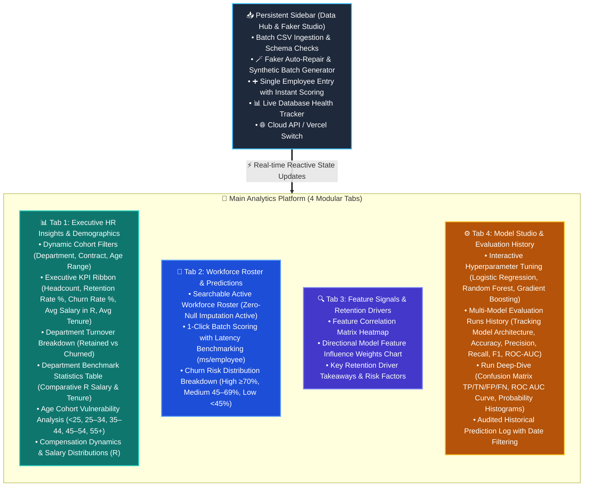

# Implementation Summary & Technical Architecture

This document serves as the implementation companion to `detailed_tab_breakdown.md`, detailing the architecture, currency localization (South African Rand - ZAR / R), model evaluation tracking by algorithm, and the complete 4-tab stakeholder interface.

---

## 1. Executive Implementation Overview

The Employee Churn Intelligence platform has been engineered specifically for HR analysts, people managers, and executive stakeholders in South Africa. All currency metrics, salary visualizations, and baseline compensation models are standardized in **South African Rands (R / ZAR)**.

---

## 2. Multi-Model Architecture & Evaluation Governance

The platform provides explicit model architecture tracking across all evaluation runs, allowing stakeholders to benchmark which classification algorithms achieve the highest discriminatory power for their workforce:

### Supported Algorithms & Hyperparameter Spaces:
1. **Logistic Regression (Linear / Interpretable)**:
   - **Regularization Strength ($C$)**: Tunable from $0.01$ to $10.0$.
   - **Class Weighting**: `None` or `balanced` (penalizes minority churn misclassifications).
   - **Solvers**: `lbfgs`, `saga`, `liblinear`.
2. **Random Forest (Ensemble / Non-Linear)**:
   - **Estimators ($n$)**: $20$ to $300$ trees.
   - **Max Depth**: $2$ to $15$ levels.
   - **Min Samples Split**: $2$, $5$, $10$.
3. **Gradient Boosting (Boosting / Gradient Trees)**:
   - **Learning Rate ($\eta$)**: $0.01$ to $0.30$.
   - **Estimators ($n$)**: $20$ to $200$.
   - **Max Tree Depth**: $2$ to $8$.

### Model Evaluation Run Tracking Schema:
Every retraining event logs the specific model architecture alongside its holdout test metrics:

| Field | Type | Description |
| :--- | :--- | :--- |
| `run_id` | `INTEGER PRIMARY KEY` | Auto-incrementing identifier for the training event. |
| `model_architecture` | `TEXT` | Algorithm used (`Logistic Regression`, `Random Forest`, `Gradient Boosting`). |
| `accuracy` | `REAL` | Overall classification correctness on holdout split ($20\%$). |
| `precision` | `REAL` | Proportion of predicted churners who actually churned ($TP / (TP + FP)$). |
| `recall` | `REAL` | Proportion of actual churners correctly caught ($TP / (TP + FN)$). |
| `f1` | `REAL` | Harmonic mean of precision and recall ($2 \cdot (P \cdot R) / (P + R)$). |
| `roc_auc` | `REAL` | Area Under the Receiver Operating Characteristic curve. |
| `run_timestamp` | `TIMESTAMP` | ISO-8601 audit timestamp. |

---

## 3. South African Rand (ZAR / R) Localization

All financial computations, data quality rules, salary analytics, and prediction inputs are localized for the South African market:

1. **Compensation Metrics**:
   - Macro average compensation formatted as `R XX,XXX`.
   - Department salary benchmarks: `Avg Sal (Retained)` and `Avg Sal (Churned)` displayed in Rands.
   - Salary Disparity analysis across departments and contract tiers.
2. **Input Validation**:
   - Single-employee and batch annual income accepts South African Rand figures (e.g. `R 52,000.00` to `R 1,500,000.00+`).
3. **Visual Analytics**:
   - Histogram distribution charts calibrated to Rand salary ranges.
